# provian-reference-gate

## Contributing

Agents and human contributors clear a **50 PVT burn-to-present gate to open a PR** on this repository, **once per PR**. Present against the PR’s signed challenge as the wallet linked to its GitHub author. Further pushes require no additional burn. Agents obtain a wallet with the app-provided curl install command and link GitHub with `provian git-identity github-link`; human contributors [get the app](https://provian.ai/download) and link **Connect → GitHub**. Git Witness earning is unchanged. Clearance only unlocks merge; the repository owner must approve the current head on GitHub before the App merges. [Full contributing walkthrough](CONTRIBUTING.md).

The reference gate for [Provian](https://provian.ai) presentations. A gate is any system that has
to decide what to do with an instruction from an agent, or a person, it has never met: a payment
rail about to settle, a code forge about to merge, a controller about to run a privileged job. The
gate makes the actor **present its record first**, verifies the presentation itself, applies its
own predicates, and decides. Reading the record costs the gate nothing: no Provian account, no key
from Provian, no fee.

Burn-to-present is Provian's foundational burn, and gates like this one are where most of it
happens. A gate does not register with Provian. Provian proves the presentation is real: burned,
signed, bound to this gate's challenge, not reused. What the gate grants on it is the gate's own
policy. An agent does not burn on every transaction: one presentation opens the
relationship, and the gate decides how long it trusts it and when it asks again.

<p align="center">
  <picture>
    <source media="(prefers-color-scheme: dark)" srcset="docs/gate-handshake-dark.svg">
    
  </picture>
</p>

<p align="center"><sub><b>Illustrative.</b> The counterparty-onboarding example, run on the two fixture presenters in this repo (<code>npm run contrast</code>). Both presentations are signed by the reference's own test issuer key, not by Provian, and checked by the same verifier a live gate uses.</sub></p>

This repository is one standalone service and one library, both walking the complete path:

1. **Identity** — the gate's Ed25519 key, published at `https://<your-domain>/.well-known/provian-requester.json`.
2. **Challenge** — a signed `provian-challenge-v1` envelope naming the gate's questions (predicates).
3. **Present** — the presenter burns PVT and the relay hands it a co-signed token; the presenter returns it.
4. **Verify** — the stateless relay verify and a local verify against Provian's published keys (and Base, for a PE fact), both required; each presentation accepted **once**.
5. **Decide** — every predicate true, the gate's own rule over Standing (always present, never redactable), the addressed presenter. Unknown or failed is **blocked**, not warned. Every decision is written as a **report**.

Everything is in [`src/gate.ts`](src/gate.ts), written to be read as a protocol walkthrough: the
challenge shape, the verify call, the key check and the predicate evaluation are visible in the
code, so a shop in any language can port it. Provian defines no policy vocabulary; the five
worked examples under [`src/examples`](src/examples) are complete decisions, not recommendations.

The mechanics were proven live on 9 October 2026: three presentations burned on Base against a
deployed instance of this gate, each blocked with its reasons, each replay refused.

## What a key check says, and what the gate says

The same request — the counterparty-onboarding challenge — from two presenters. Both hold a valid
key. Both presentations verify. A signature check stops there and says the same thing twice. The
gate reads the record.

<table>
<tr><th></th><th>A signature check</th><th>The gate's report</th></tr>
<tr>
<td valign="top"><b>Fresh key</b><br><sub>a valid key and nothing behind it</sub></td>
<td valign="top"><code>valid</code><br><sub>signed by the issuer; the presenter holds its key</sub></td>
<td valign="top"><pre>Identity
  No witnessed act on record: nothing stands behind this key.
  Fewer than 30 distinct days active under witness.
  Fewer than 10 active days in the last 90.
  No registered device.
  An empty hash chain: no act has ever been recorded.
Accountable human
  No person is linked to this agent or answers for it.
  No turn a person directed.
Witnessed history
  Fewer than 25 acts in the last 90 days witnessed by something other than the actor.
  No hardware-rooted act in the last 90 days.
Standing
  No adverse event on record.
  No open bond claim against it; no active invalidation.
Counterparties
  Fewer than 3 independent parties built on its output.
  It cites no one’s work but its own.
  No independent party paid it in the last 90 days.
Money witnessed
  No inbound payment the chain witnessed.
  No inbound payment the chain witnessed in the last 90 days.
  No financial act the chain witnessed in the last 90 days.
  No promise fulfilled.
  No promise defaulted.
  No escrow completed as the provider.

BLOCK
  Fewer than 30 distinct days active under witness (asked: continuity.active_days gte 30).
  Fewer than 10 active days in the last 90 (asked: continuity.active_days_90d gte 10).
  Fewer than 25 acts in the last 90 days witnessed by something other than the actor (asked: work.witnessed_90d gte 25).
  Fewer than 3 independent parties built on its output (asked: consumption.independent_parties gte 3).
  No person is linked to this agent or answers for it (asked: accountability.human_beneficiary eq 1).</pre></td>
</tr>
<tr>
<td valign="top"><b>Established agent</b><br><sub>the record the network produces at maturity</sub></td>
<td valign="top"><code>valid</code><br><sub>signed by the issuer; the presenter holds its key</sub></td>
<td valign="top"><pre>Identity
  First witnessed 2025-08-05, 431 days before this presentation.
  At least 30 distinct days active under witness.
  At least 10 active days in the last 90.
  3 registered devices.
  48,210 acts in its hash chain.
Accountable human
  A person is linked to this agent and answers for it.
  15,312 turns a person directed.
Witnessed history
  At least 25 acts in the last 90 days witnessed by something other than the actor.
  1,284 commits a code forge witnessed.
  9,412 hardware-rooted acts in the last 90 days.
  100% of its work in the last 90 days is hardware-rooted.
Standing
  One adverse event on record: a bond it posted expired — none in the last 90 days, within the last year. It stays in every presentation this actor makes.
  No open bond claim against it; no active invalidation.
Counterparties
  At least 3 independent parties built on its output.
  212 owners other than itself whose work it cites.
  19 independent parties paid it in the last 90 days.
Money witnessed
  640 inbound payments the chain witnessed.
  71 inbound payments the chain witnessed in the last 90 days.
  184 financial acts the chain witnessed in the last 90 days.
  31 promises fulfilled.
  No promise defaulted.
  44 escrows completed as the provider.

ALLOW
  Every question this gate asked was answered yes, and nothing in Standing objects.</pre></td>
</tr>
</table>

<sub><b>Illustrative</b> — fixture presenters, test issuer key. Generated by <code>npm run contrast</code>; every report for all five examples is in <a href="docs/illustrative-contrast.txt"><code>docs/illustrative-contrast.txt</code></a> and the full record in <a href="docs/illustrative-contrast.json"><code>docs/illustrative-contrast.json</code></a>.</sub>

The report's six headings are fixed: **Identity, Accountable human, Witnessed history, Standing,
Counterparties, Money witnessed**, then the decision and its reasons. A line reads a fact the gate
asked as its co-signed answer ("at least 25"), never the raw number; a fact the presenter disclosed
raw reads as the number; a record the challenge NAMED reads under Witnessed history as the presenter
answered it (disclosed with what it carries, declined, or nothing held); Standing is always shown. Note the established agent's one adverse event:
the onboarding gate admits it, and the event is still printed — it rides in every presentation the
agent ever makes.

## How this extends

Five questions the agentic world keeps asking. Each is a family of vocabulary fields, and each is
read by an example in this repo:

| Question | Vocabulary | Read by |
|---|---|---|
| **Identity** — who is this? | `continuity.first_seen_ms`, `continuity.active_days[_30d\|_90d\|_365d]`, `continuity.registered_devices`, `continuity.chain_depth` — computed by the relay from the actor's own witnessed chain. The gate runs no registry. | [`counterparty-onboarding`](src/examples/counterparty-onboarding.ts) (`continuity.active_days gte 30`, `continuity.active_days_90d gte 10`); the Identity section of every report |
| **Accountability** — who answers for it? | `accountability.human_beneficiary` (a person is linked), `accountability.supervised_turns`; `standing.*`, always present and never redactable | [`counterparty-onboarding`](src/examples/counterparty-onboarding.ts) and [`repository-merge`](src/examples/repository-merge.ts) (`accountability.human_beneficiary eq 1`); every example's Standing predicates and `standing(view)` rule |
| **Audit** — what has it done? | `work.<family>.<witness_class>`, `work.witnessed[_Nd]`, `work.hardware_rooted[_Nd]`, `share.witness[_Nd].<class>` — work counted by who witnessed it; and the attestation FACTS of that work — `share.issuer[_Nd].<root>`, `share.measurement[_Nd].<digest>`, `share.region[_Nd].<region>` — derived by the relay from each act's verified hardware report | [`repository-merge`](src/examples/repository-merge.ts) (`work.compute.forge_witnessed gte 10`); [`mission-critical-action`](src/examples/mission-critical-action.ts) (every act in the window under one issuer root, one launch measurement, one region — the facts, never the class) |
| **Credentials** — can it prove the specific thing? | `consumption.independent_parties` (others built on its output), `money.independent_payers_90d` (distinct parties the chain saw pay it, past the same-owner fence), `money.witnessed_inbound_90d`; and a **named disclosure** — the challenge names one PE by output digest under an issuer root, with elected content, and the presenter discloses it or declines, either answer signed and each record proven against its anchored act | [`counterparty-onboarding`](src/examples/counterparty-onboarding.ts) (`consumption.independent_parties gte 3`); [`payment-rail`](src/examples/payment-rail.ts); [`sensitive-site`](src/examples/sensitive-site.ts) (a credential by digest + issuer + content) |
| **Attribution** — when something goes wrong, who was it? | `standing.*` by type and window — an adverse event is counted against the party at fault and stays in every presentation; `accountability.human_beneficiary` says a person is linked (the presentation carries the flag; the link itself stays in the record) | `adverseStandingOf` in [`src/policy.ts`](src/policy.ts) and the Standing section of every report; the established fixture's expired bond is held against it at the merge and mission-critical gates |

A gate grows in three ways, and none of them changes `src/gate.ts`:

- **Add a predicate.** Push `{ field, op, threshold }` (or `{ field, op: 'in', set }`) onto a
  policy's `predicates`. Any field in the live vocabulary works —
  `GET https://api.provian.ai/v1/schema/pe` → `presentation.vocabulary` — under the frozen grammar.
  The mission-critical example's three attestation shares are exactly this.
- **Add a witness.** When the network gains a witness — a forge, a payment rail, a chip — its work
  lands under a witness class and family the vocabulary already counts (`work.<family>.<class>`,
  `share.witness_90d.<class>`). Ask the new key. A key that was never witnessed reads 0, so asking it
  early fails closed.
- **Name a record.** The reputation tier's facts are counts and booleans, nothing of what the work
  was. A gate that needs the specific thing puts a disclosure request on its challenge
  (`disclosures: [{ kind: 'pe', output_digest, issuer, content }]`, or `kind: 'witness'` for the
  presenter's records under an issuer or signer) and a `disclosed(view)` rule on its policy. The
  presenter elects — discloses the records it holds, or declines — and either answer is signed; the
  verifier proves every disclosed record against its anchored act on Base (`requireOnchain: true`
  is already on) and refuses a mismatch; the gate reads what was disclosed. The sensitive-site
  example is exactly this. The other four stay at the floor.

## Quickstart

Node 20 or later and a domain you control.

```bash
git clone https://github.com/LongevityManiac/provian-reference-gate.git
cd provian-reference-gate
npm install
npm run build
GATE_DOMAIN=gate.example.com npm start
```

On first start the service generates the gate key into `./data/requester-key.json` (keep it
private) and serves its public half at `/.well-known/provian-requester.json`. Put the service
behind TLS on `gate.example.com`: the Provian relay fetches that document over HTTPS from exactly
that hostname when a presenter presents against your challenge.

| Route | What it does |
|---|---|
| `GET /.well-known/provian-requester.json` | The gate's identity |
| `GET /` | The policies this gate runs, with their predicates |
| `POST /gates/<policy>/challenge` `{ "presenter"?: "0x…" }` | Issue a signed challenge → `{ challenge }` |
| `POST /gates/<policy>/decide` `{ "token": "…" }` | Verify once, evaluate, decide → `200` allow / `403` block, body = the decision with its report |

`<policy>` is one of `counterparty-onboarding`, `payment-rail`, `repository-merge`, `mission-critical-action`, `sensitive-site`.

The same path as two commands, no HTTP:

```bash
GATE_DOMAIN=gate.example.com npm run walkthrough -- issue counterparty-onboarding > challenge.json
# hand challenge.json to the presenter over any channel; it returns a token
GATE_DOMAIN=gate.example.com npm run walkthrough -- decide counterparty-onboarding --challenge challenge.json --token token.txt
```

Exit code `0` is allow, `2` is block; the decision prints as JSON on stdout and its report on stderr.

The illustrative contrast — every example, both fixture presenters, each replayed — with no network:

```bash
npm run build && npm run contrast
```

### As a library

```ts
import { Gate, generateGateKey, counterpartyOnboarding, formatReport } from 'provian-reference-gate';

const key = generateGateKey();                                  // once; publish key.publicJwk at your well-known path
const gate = await Gate.create({ domain: 'gate.example.com', key });

const challenge = gate.issueChallenge(counterpartyOnboarding);  // hand JSON.stringify(challenge) to the presenter
const decision = await gate.decide(counterpartyOnboarding, token);
console.log(formatReport(decision.report));                     // the six headings, then the decision and why
if (decision.decision !== 'allow') refuse(decision.report.reasons);
```

A policy is `{ slug, name, action, description, predicates, disclosures?, standing(view), disclosed?(view) }`. Write your own.

## Optional operator admission log

The gate operator decides whether to keep an admission log. The service and walkthrough keep it
by default. Every returned decision writes exactly one receipt: **ALLOW and BLOCK**, including
unsigned, expired, presenter-mismatch, tier, false-predicate and replay refusals. Disable it with
one setting:

```sh
GATE_ADMISSION_LOG=false npm start
```

Turning logging off leaves the verification, policy and one-shot replay checks unchanged. The
seen-store is separate; the log never grants acceptance or releases a replay claim. In the
library, logging is enabled only when the operator attaches it:

```ts
import { Gate, createFileAdmissionLog, reverifyAdmission } from 'provian-reference-gate';

const gate = await Gate.create({
  domain: 'gate.example.com', key,
  admissionLog: createFileAdmissionLog('./operator-data/admissions'),
  seenStore, // your durable replay store, independently configured
});
// Omit admissionLog to turn logging off. Keep the same seenStore.
```

Receipts live under `<GATE_DATA_DIR>/admissions/entries/`, one create-only JSON file per decision,
with owner-only permissions and file/directory fsync before the decision returns. No overwrite,
update or delete API exists. Retained challenges live beside them under `challenges/`, so later
replay/expiry refusals can include the issued envelope even after its live nonce is forgotten.
Challenge retention is never used to authorize acceptance. A malformed token with no identifiable
issued challenge records `challenge: null`; nothing is invented. Mount operator-owned durable
storage for a container. Nothing in the log is sent to Provian; relay verification remains
stateless and gates still do not register.

Each receipt contains the **exact token string** (including its presenter PoP, Provian
co-signature, presentation ID and burn ID), challenge, verification result, decision, six-heading
reasons report and receipt time. It retains the public JWKS actually used, including a refreshed
key after rotation, plus the gate's public key. It never stores a private key, HTTP headers, IPs,
or an owner/vocabulary lookup. The only presenter data is what arrived in the presentation.
The gate signs the whole receipt with a domain-separated Ed25519 signature; pin its public key
independently at setup and retain old public keys when rotating the gate key.

For presentations carrying anchored proofs, the receipt also retains the required Base batch
roots and existence flags from successful pinned-contract inclusion checks, or a receipt-time
root read at a recorded Base block when inclusion was refused. Offline checking repeats the outer Merkle proof,
the SDK's local proof and signature checks, and freshness at the original verification time.
The roots are the operator's signed observations of Base RPC state, **not independent proofs of
chain consensus**. An unavailable read is recorded as unavailable, never as a successful anchor.
A receipt signature detects changed content; log completeness/deletion protection belongs to the
operator's storage and backup policy. Use append-only/WORM storage when that is required.

An attached log must finish its durable write before a decision is returned. If storage fails,
`decide` throws `AdmissionLogError`; the HTTP service returns 503 and never admits the request.
It does not append a second fallback decision or undo a replay claim.

### Run the five examples and re-verify a receipt

```sh
npm run build
npm run contrast -- --json data/contrast.json
# All five policies, both presenters: 10 decisions + 10 replay refusals = 20 receipt files.
# The contrast record includes the example gate's public JWK; retain it when running the example.
npm run reverify-admission -- docs/admission-example.json docs/admission-example-gate-key.json
```

These are real log entries written by the examples through the same gate and storage path. The
presenters and issuer are explicitly illustrative test fixtures: **no production burn or Provian
signature is claimed**. The sensitive-site example uses a local anchor stub; its receipt keeps
that example's roots and can be checked after the stub stops.

[This complete example receipt](docs/admission-example.json) is the established presenter's
onboarding ALLOW. [The example's retained public key](docs/admission-example-gate-key.json)
authenticates it. For production, obtain the trusted gate key independently; copying a key out of
an untrusted receipt does not establish its identity.

<details>
<summary>Actual complete entry from the example run</summary>

```json
{
  "record": {
    "anchor_observations": [],
    "challenge": {
      "audience": "gate.example.com",
      "challenge": "eb1aa4e5900d7a832fe3362154ab9884f6d6950c7da3f9496b48371c6e8afa43",
      "expiresAt": 1791591300,
      "issuedAt": 1791590400,
      "predicates": [
        {
          "field": "continuity.active_days",
          "op": "gte",
          "threshold": 30
        },
        {
          "field": "continuity.active_days_90d",
          "op": "gte",
          "threshold": 10
        },
        {
          "field": "work.witnessed_90d",
          "op": "gte",
          "threshold": 25
        },
        {
          "field": "consumption.independent_parties",
          "op": "gte",
          "threshold": 3
        },
        {
          "field": "accountability.human_beneficiary",
          "op": "eq",
          "threshold": 1
        },
        {
          "field": "standing.adverse_events_90d",
          "op": "in",
          "set": [
            0
          ]
        },
        {
          "field": "standing.open_bond_claims_against",
          "op": "eq",
          "threshold": 0
        },
        {
          "field": "standing.invalidation_active",
          "op": "eq",
          "threshold": 0
        }
      ],
      "requester": {
        "id": "gate.example.com",
        "kid": "gate-k1",
        "type": "domain"
      },
      "sig": "C4jKFClvuheYo4p9P4yNtkpV4-YErOHO1-S5G3JYE4A9eUMxc4TwLPyvhcDxQ9766HwHwqEF19WhHg65O7ByDA",
      "v": 1
    },
    "decision": {
      "action": "Let an agent this system has never met act for the first time",
      "at": "2026-10-10T00:00:00.000Z",
      "decision": "allow",
      "disclosures": [],
      "gate": "gate.example.com",
      "policy": "counterparty-onboarding",
      "predicates": [
        {
          "field": "continuity.active_days",
          "op": "gte",
          "result": true,
          "threshold": 30
        },
        {
          "field": "continuity.active_days_90d",
          "op": "gte",
          "result": true,
          "threshold": 10
        },
        {
          "field": "work.witnessed_90d",
          "op": "gte",
          "result": true,
          "threshold": 25
        },
        {
          "field": "consumption.independent_parties",
          "op": "gte",
          "result": true,
          "threshold": 3
        },
        {
          "field": "accountability.human_beneficiary",
          "op": "eq",
          "result": true,
          "threshold": 1
        },
        {
          "field": "standing.adverse_events_90d",
          "op": "in",
          "result": true,
          "set": [
            0
          ]
        },
        {
          "field": "standing.open_bond_claims_against",
          "op": "eq",
          "result": true,
          "threshold": 0
        },
        {
          "field": "standing.invalidation_active",
          "op": "eq",
          "result": true,
          "threshold": 0
        }
      ],
      "presentation": {
        "challenge_expires_at": 1791591300,
        "id": "026273fa9f355f9dce134386b747f6752cc8e07292f47487fe652a02d0302b56",
        "presenter": {
          "address": "0x9493c31d5abf66ac25912ab08edcee6e004e1783",
          "wallet_id": "wallet_aw_illustrative_established"
        },
        "requester": {
          "id": "gate.example.com",
          "type": "domain"
        },
        "tier": "reputation"
      },
      "reasons": [
        "true: continuity.active_days gte 30",
        "true: continuity.active_days_90d gte 10",
        "true: work.witnessed_90d gte 25",
        "true: consumption.independent_parties gte 3",
        "true: accountability.human_beneficiary eq 1",
        "true: standing.adverse_events_90d in {0}",
        "true: standing.open_bond_claims_against eq 0",
        "true: standing.invalidation_active eq 0"
      ],
      "report": {
        "decision": "ALLOW",
        "reason": "Every question this gate asked was answered yes, and nothing in Standing objects.",
        "reasons": [
          "Every question this gate asked was answered yes, and nothing in Standing objects."
        ],
        "sections": [
          {
            "heading": "Identity",
            "lines": [
              {
                "fields": [
                  "continuity.first_seen_ms"
                ],
                "source": "disclosed",
                "text": "First witnessed 2025-08-05, 431 days before this presentation."
              },
              {
                "fields": [
                  "continuity.active_days"
                ],
                "source": "answer",
                "text": "At least 30 distinct days active under witness."
              },
              {
                "fields": [
                  "continuity.active_days_90d"
                ],
                "source": "answer",
                "text": "At least 10 active days in the last 90."
              },
              {
                "fields": [
                  "continuity.registered_devices"
                ],
                "source": "disclosed",
                "text": "3 registered devices."
              },
              {
                "fields": [
                  "continuity.chain_depth"
                ],
                "source": "disclosed",
                "text": "48,210 acts in its hash chain."
              }
            ]
          },
          {
            "heading": "Accountable human",
            "lines": [
              {
                "fields": [
                  "accountability.human_beneficiary"
                ],
                "source": "answer",
                "text": "A person is linked to this agent and answers for it."
              },
              {
                "fields": [
                  "accountability.supervised_turns"
                ],
                "source": "disclosed",
                "text": "15,312 turns a person directed."
              }
            ]
          },
          {
            "heading": "Witnessed history",
            "lines": [
              {
                "fields": [
                  "work.witnessed_90d"
                ],
                "source": "answer",
                "text": "At least 25 acts in the last 90 days witnessed by something other than the actor."
              },
              {
                "fields": [
                  "work.compute.forge_witnessed"
                ],
                "source": "disclosed",
                "text": "1,284 commits a code forge witnessed."
              },
              {
                "fields": [
                  "work.hardware_rooted_90d"
                ],
                "source": "disclosed",
                "text": "9,412 hardware-rooted acts in the last 90 days."
              },
              {
                "fields": [
                  "share.witness_90d.hardware_rooted"
                ],
                "source": "disclosed",
                "text": "100% of its work in the last 90 days is hardware-rooted."
              }
            ]
          },
          {
            "heading": "Standing",
            "lines": [
              {
                "fields": [
                  "standing.adverse_events",
                  "standing.adverse_events_90d",
                  "standing.adverse_events_365d"
                ],
                "source": "standing",
                "text": "One adverse event on record: a bond it posted expired \u2014 none in the last 90 days, within the last year. It stays in every presentation this actor makes."
              },
              {
                "fields": [
                  "standing.open_bond_claims_against",
                  "standing.invalidation_active"
                ],
                "source": "standing",
                "text": "No open bond claim against it; no active invalidation."
              }
            ]
          },
          {
            "heading": "Counterparties",
            "lines": [
              {
                "fields": [
                  "consumption.independent_parties"
                ],
                "source": "answer",
                "text": "At least 3 independent parties built on its output."
              },
              {
                "fields": [
                  "coupling.independent_owners"
                ],
                "source": "disclosed",
                "text": "212 owners other than itself whose work it cites."
              },
              {
                "fields": [
                  "money.independent_payers_90d"
                ],
                "source": "disclosed",
                "text": "19 independent parties paid it in the last 90 days."
              }
            ]
          },
          {
            "heading": "Money witnessed",
            "lines": [
              {
                "fields": [
                  "money.witnessed_inbound"
                ],
                "source": "disclosed",
                "text": "640 inbound payments the chain witnessed."
              },
              {
                "fields": [
                  "money.witnessed_inbound_90d"
                ],
                "source": "disclosed",
                "text": "71 inbound payments the chain witnessed in the last 90 days."
              },
              {
                "fields": [
                  "money.witnessed_financial_90d"
                ],
                "source": "disclosed",
                "text": "184 financial acts the chain witnessed in the last 90 days."
              },
              {
                "fields": [
                  "money.promises_fulfilled"
                ],
                "source": "disclosed",
                "text": "31 promises fulfilled."
              },
              {
                "fields": [
                  "money.promises_defaulted"
                ],
                "source": "disclosed",
                "text": "No promise defaulted."
              },
              {
                "fields": [
                  "money.escrows_completed_as_provider"
                ],
                "source": "disclosed",
                "text": "44 escrows completed as the provider."
              }
            ]
          }
        ]
      },
      "standing": {
        "adverse_events": 1,
        "adverse_events_30d": 0,
        "adverse_events_365d": 1,
        "adverse_events_90d": 0,
        "bond_active": true,
        "by_type": {
          "standing.bond_expired": 1
        },
        "invalidation_active": false,
        "open_bond_claims_against": 0
      },
      "verification": {
        "local": "valid",
        "onchain_checked": false,
        "relay": "skipped",
        "replay": "first"
      }
    },
    "gate_public_jwk": {
      "crv": "Ed25519",
      "kid": "gate-k1",
      "kty": "OKP",
      "x": "r4j16CEDAfi3C8I4MqiflU0NVfyr-UGliEvtdzdRtUo"
    },
    "id": "01b2d425-7e88-4c6e-a5f2-3efd46cc642d",
    "kind": "provian-gate-admission.v1",
    "policy": {
      "action": "Let an agent this system has never met act for the first time",
      "description": "Admit a stranger when it has been active under witness for a month and is active now, its recent work was witnessed, independent parties have built on its output, a person answers for it, and nothing adverse stands against it in the last 90 days.",
      "name": "Counterparty onboarding",
      "predicates": [
        {
          "field": "continuity.active_days",
          "op": "gte",
          "threshold": 30
        },
        {
          "field": "continuity.active_days_90d",
          "op": "gte",
          "threshold": 10
        },
        {
          "field": "work.witnessed_90d",
          "op": "gte",
          "threshold": 25
        },
        {
          "field": "consumption.independent_parties",
          "op": "gte",
          "threshold": 3
        },
        {
          "field": "accountability.human_beneficiary",
          "op": "eq",
          "threshold": 1
        },
        {
          "field": "standing.adverse_events_90d",
          "op": "in",
          "set": [
            0
          ]
        },
        {
          "field": "standing.open_bond_claims_against",
          "op": "eq",
          "threshold": 0
        },
        {
          "field": "standing.invalidation_active",
          "op": "eq",
          "threshold": 0
        }
      ],
      "slug": "counterparty-onboarding"
    },
    "received_at": "2026-10-29T21:11:58.509Z",
    "token": "eyJ0aWVyIjoicmVwdXRhdGlvbiIsInBheWxvYWQiOnsidiI6MiwidGllciI6InJlcHV0YXRpb24iLCJpc3MiOiJodHRwczovL3Byb3ZpYW4uYWkiLCJzdWIiOiJ3YWxsZXRfYXdfaWxsdXN0cmF0aXZlX2VzdGFibGlzaGVkIiwicHJlc2VudGVyX2FkZHJlc3MiOiIweDk0OTNjMzFkNWFiZjY2YWMyNTkxMmFiMDhlZGNlZTZlMDA0ZTE3ODMiLCJhdWQiOiJnYXRlLmV4YW1wbGUuY29tIiwiY2hhbCI6ImViMWFhNGU1OTAwZDdhODMyZmUzMzYyMTU0YWI5ODg0ZjZkNjk1MGM3ZGEzZjk0OTZiNDgzNzFjNmU4YWZhNDMiLCJpYXQiOjE3OTE1OTA0MDAsImV4cCI6MTc5MTU5MDcwMCwianRpIjoicHJlc18xYjI4ZGQ3MDM1YjhiYzRhIiwiYnVybl9pZCI6IjAyNjI3M2ZhOWYzNTVmOWRjZTEzNDM4NmI3NDdmNjc1MmNjOGUwNzI5MmY0NzQ4N2ZlNjUyYTAyZDAzMDJiNTYiLCJwcmVzZW50ZXJfcG9wIjp7InNjaGVtZSI6ImVjZHNhX3NoYTI1Nl9zZWNwMjU2azEiLCJzaWduYXR1cmUiOiIzMDQ1MDIyMTAwZDNkZTMwMTliNDI2NzgwM2JkYmVlODE1Y2M0YzZjYjhjYzE1ZTYxNzY1ZWFlYTE2OTUxM2Q3YjVkYzJhOTc3NDAyMjAyYWQ4NmQ0NzJhZGU4YzFhYWQxZWFkY2NiNDdhNzM5ZDAwYmIzZTJmMzdlYWFlY2UyZTZlNWQyODM0OGRhNmNmIiwicHVia2V5IjoiYmFjOGQ4ODdjYTcxMTQxNDA1NjVlNGVhMGIxMzMwMDY3NTQxNjE1MzYxYjMyNGQ4OWZjZmY5ZDU3MWRjMGU0ZTFkYjA0OGY2Njg0ZGZlZGUxMmFiMDYxNDY1NDdiNjZkNjY2MmNhNWY3Nzk5ZjM4NGViOGU2MzM5ZGIwMTVmMzcifSwicmVwdXRhdGlvbiI6eyJmYWN0cyI6eyJzdGFuZGluZy5hZHZlcnNlX2V2ZW50cyI6MSwic3RhbmRpbmcuYWR2ZXJzZV9ldmVudHNfMzBkIjowLCJzdGFuZGluZy5hZHZlcnNlX2V2ZW50c185MGQiOjAsInN0YW5kaW5nLmFkdmVyc2VfZXZlbnRzXzM2NWQiOjEsInN0YW5kaW5nLmJvbmRfYWN0aXZlIjoxLCJzdGFuZGluZy5vcGVuX2JvbmRfY2xhaW1zX2FnYWluc3QiOjAsInN0YW5kaW5nLmludmFsaWRhdGlvbl9hY3RpdmUiOjAsInN0YW5kaW5nLmJvbmRfZXhwaXJlZCI6MSwiYWN0b3IuaXNfYWdlbnQiOjEsImNvbnRpbnVpdHkuZmlyc3Rfc2Vlbl9tcyI6MTc1NDM1MjAwMDAwMCwiY29udGludWl0eS5sYXN0X3NlZW5fbXMiOjE3OTE1ODY4MDAwMDAsImNvbnRpbnVpdHkuY2hhaW5fZGVwdGgiOjQ4MjEwLCJjb250aW51aXR5LmFjdGl2ZV9kYXlzXzMwZCI6MjksImNvbnRpbnVpdHkuYWN0aXZlX2RheXNfMzY1ZCI6MzE4LCJjb250aW51aXR5LnN0cmVha19kYXlzIjo0MSwiY29udGludWl0eS5yZWdpc3RlcmVkX2RldmljZXMiOjMsImFjY291bnRhYmlsaXR5LnN1cGVydmlzZWRfdHVybnMiOjE1MzEyLCJ3b3JrLnRvdGFsIjo0ODIxMCwid29yay53aXRuZXNzZWQiOjQ3OTY0LCJ3b3JrLmNvbXB1dGUuZm9yZ2Vfd2l0bmVzc2VkIjoxMjg0LCJ3b3JrLmhhcmR3YXJlX3Jvb3RlZCI6MjE2NDAsIndvcmsuaGFyZHdhcmVfcm9vdGVkXzkwZCI6OTQxMiwic2hhcmUud2l0bmVzc185MGQuaGFyZHdhcmVfcm9vdGVkIjoxMDAwMCwiY29tcG9zaXRpb24uYXR0ZXN0ZWRfaXNzdWVycyI6MSwiY29tcG9zaXRpb24ubWVhc3VyZW1lbnRzIjoxLCJjb21wb3NpdGlvbi5hdHRlc3RlZF9yZWdpb25zIjoxLCJjb21wb3NpdGlvbi5pc3N1ZXIuNTk0NzU5NTk0YjliNjE1MjRmNmM4ZWY2NjhmNzE3N2Y3YjkwNjZiYzA2NzRmMmY0OWZlOWUwNTJiZTc4YmViMiI6MjE2NDAsImNvbXBvc2l0aW9uLm1lYXN1cmVtZW50LnNoYTI1Njo5ZjJjMWE3ZTBkNGI2YzhlM2E1ZjdkOWIxYzNlNWE3ZjJkNGI2YzhlMGExZjNkNWI3YzllMWEzZjVkN2I5YzFlIjoyMTY0MCwiY29tcG9zaXRpb24ucmVnaW9uLnVzLWNlbnRyYWwxIjoyMTY0MCwic2hhcmUuaXNzdWVyXzkwZC41OTQ3NTk1OTRiOWI2MTUyNGY2YzhlZjY2OGY3MTc3ZjdiOTA2NmJjMDY3NGYyZjQ5ZmU5ZTA1MmJlNzhiZWIyIjoxMDAwMCwic2hhcmUubWVhc3VyZW1lbnRfOTBkLnNoYTI1Njo5ZjJjMWE3ZTBkNGI2YzhlM2E1ZjdkOWIxYzNlNWE3ZjJkNGI2YzhlMGExZjNkNWI3YzllMWEzZjVkN2I5YzFlIjoxMDAwMCwic2hhcmUucmVnaW9uXzkwZC51cy1jZW50cmFsMSI6MTAwMDAsImNvbnN1bXB0aW9uLmVkZ2VzIjoyOTQxLCJjb3VwbGluZy5kaXN0aW5jdF9vd25lcnMiOjIzMCwiY291cGxpbmcuaW5kZXBlbmRlbnRfb3duZXJzIjoyMTIsIm1vbmV5LndpdG5lc3NlZF9pbmJvdW5kIjo2NDAsIm1vbmV5LndpdG5lc3NlZF9pbmJvdW5kXzkwZCI6NzEsIm1vbmV5LmluZGVwZW5kZW50X3BheWVycyI6MTE4LCJtb25leS5pbmRlcGVuZGVudF9wYXllcnNfOTBkIjoxOSwibW9uZXkud2l0bmVzc2VkX2ZpbmFuY2lhbCI6MTEyMiwibW9uZXkud2l0bmVzc2VkX2ZpbmFuY2lhbF85MGQiOjE4NCwibW9uZXkucHJvbWlzZXNfZnVsZmlsbGVkIjozMSwibW9uZXkucHJvbWlzZXNfZGVmYXVsdGVkIjowLCJtb25leS5lc2Nyb3dzX2NvbXBsZXRlZF9hc19wcm92aWRlciI6NDR9LCJwcmVkaWNhdGVzIjpbeyJmaWVsZCI6ImNvbnRpbnVpdHkuYWN0aXZlX2RheXMiLCJvcCI6Imd0ZSIsInRocmVzaG9sZCI6MzAsInJlc3VsdCI6dHJ1ZX0seyJmaWVsZCI6ImNvbnRpbnVpdHkuYWN0aXZlX2RheXNfOTBkIiwib3AiOiJndGUiLCJ0aHJlc2hvbGQiOjEwLCJyZXN1bHQiOnRydWV9LHsiZmllbGQiOiJ3b3JrLndpdG5lc3NlZF85MGQiLCJvcCI6Imd0ZSIsInRocmVzaG9sZCI6MjUsInJlc3VsdCI6dHJ1ZX0seyJmaWVsZCI6ImNvbnN1bXB0aW9uLmluZGVwZW5kZW50X3BhcnRpZXMiLCJvcCI6Imd0ZSIsInRocmVzaG9sZCI6MywicmVzdWx0Ijp0cnVlfSx7ImZpZWxkIjoiYWNjb3VudGFiaWxpdHkuaHVtYW5fYmVuZWZpY2lhcnkiLCJvcCI6ImVxIiwidGhyZXNob2xkIjoxLCJyZXN1bHQiOnRydWV9LHsiZmllbGQiOiJzdGFuZGluZy5hZHZlcnNlX2V2ZW50c185MGQiLCJvcCI6ImluIiwic2V0IjpbMF0sInJlc3VsdCI6dHJ1ZX0seyJmaWVsZCI6InN0YW5kaW5nLm9wZW5fYm9uZF9jbGFpbXNfYWdhaW5zdCIsIm9wIjoiZXEiLCJ0aHJlc2hvbGQiOjAsInJlc3VsdCI6dHJ1ZX0seyJmaWVsZCI6InN0YW5kaW5nLmludmFsaWRhdGlvbl9hY3RpdmUiLCJvcCI6ImVxIiwidGhyZXNob2xkIjowLCJyZXN1bHQiOnRydWV9XSwicmVkYWN0ZWQiOltdfSwiY2hhbF9leHAiOjE3OTE1OTEzMDAsInJlcXVlc3RlciI6eyJ0eXBlIjoiZG9tYWluIiwiaWQiOiJnYXRlLmV4YW1wbGUuY29tIn19LCJwcm92aWFuX2p3cyI6ImV5SmhiR2NpT2lKRlpFUlRRU0lzSW10cFpDSTZJbWxzYkhWemRISmhkR2wyWlMxcGMzTjFaWEl0YXpFaUxDSjBlWEFpT2lKd2NtOTJhV0Z1TFhCeVpYTmxiblJoZEdsdmJpdHFkM1FpZlEuZXlKMklqb3lMQ0owYVdWeUlqb2ljbVZ3ZFhSaGRHbHZiaUlzSW1semN5STZJbWgwZEhCek9pOHZjSEp2ZG1saGJpNWhhU0lzSW5OMVlpSTZJbmRoYkd4bGRGOWhkMTlwYkd4MWMzUnlZWFJwZG1WZlpYTjBZV0pzYVhOb1pXUWlMQ0p3Y21WelpXNTBaWEpmWVdSa2NtVnpjeUk2SWpCNE9UUTVNMk16TVdRMVlXSm1OalpoWXpJMU9URXlZV0l3T0dWa1kyVmxObVV3TURSbE1UYzRNeUlzSW1GMVpDSTZJbWRoZEdVdVpYaGhiWEJzWlM1amIyMGlMQ0pqYUdGc0lqb2laV0l4WVdFMFpUVTVNREJrTjJFNE16Sm1aVE16TmpJeE5UUmhZams0T0RSbU5tUTJPVFV3WXpka1lUTm1PVFE1Tm1JME9ETTNNV00yWlRoaFptRTBNeUlzSW1saGRDSTZNVGM1TVRVNU1EUXdNQ3dpWlhod0lqb3hOemt4TlRrd056QXdMQ0pxZEdraU9pSndjbVZ6WHpGaU1qaGtaRGN3TXpWaU9HSmpOR0VpTENKaWRYSnVYMmxrSWpvaU1ESTJNamN6Wm1FNVpqTTFOV1k1WkdObE1UTTBNemcyWWpjME4yWTJOelV5WTJNNFpUQTNNamt5WmpRM05EZzNabVUyTlRKaE1ESmtNRE13TW1JMU5pSXNJbkJ5WlhObGJuUmxjbDl3YjNBaU9uc2ljMk5vWlcxbElqb2laV05rYzJGZmMyaGhNalUyWDNObFkzQXlOVFpyTVNJc0luTnBaMjVoZEhWeVpTSTZJak13TkRVd01qSXhNREJrTTJSbE16QXhPV0kwTWpZM09EQXpZbVJpWldVNE1UVmpZelJqTm1OaU9HTmpNVFZsTmpFM05qVmxZV1ZoTVRZNU5URXpaRGRpTldSak1tRTVOemMwTURJeU1ESmhaRGcyWkRRM01tRmtaVGhqTVdGaFpERmxZV1JqWTJJME4yRTNNemxrTURCaVlqTmxNbVl6TjJWaFlXVmpaVEpsTm1VMVpESTRNelE0WkdFMlkyWWlMQ0p3ZFdKclpYa2lPaUppWVdNNFpEZzROMk5oTnpFeE5ERTBNRFUyTldVMFpXRXdZakV6TXpBd05qYzFOREUyTVRVek5qRmlNekkwWkRnNVptTm1aamxrTlRjeFpHTXdaVFJsTVdSaU1EUTRaalkyT0RSa1ptVmtaVEV5WVdJd05qRTBOalUwTjJJMk5tUTJOall5WTJFMVpqYzNPVGxtTXpnMFpXSTRaVFl6TXpsa1lqQXhOV1l6TnlKOUxDSnlaWEIxZEdGMGFXOXVJanA3SW1aaFkzUnpJanA3SW5OMFlXNWthVzVuTG1Ga2RtVnljMlZmWlhabGJuUnpJam94TENKemRHRnVaR2x1Wnk1aFpIWmxjbk5sWDJWMlpXNTBjMTh6TUdRaU9qQXNJbk4wWVc1a2FXNW5MbUZrZG1WeWMyVmZaWFpsYm5Selh6a3daQ0k2TUN3aWMzUmhibVJwYm1jdVlXUjJaWEp6WlY5bGRtVnVkSE5mTXpZMVpDSTZNU3dpYzNSaGJtUnBibWN1WW05dVpGOWhZM1JwZG1VaU9qRXNJbk4wWVc1a2FXNW5MbTl3Wlc1ZlltOXVaRjlqYkdGcGJYTmZZV2RoYVc1emRDSTZNQ3dpYzNSaGJtUnBibWN1YVc1MllXeHBaR0YwYVc5dVgyRmpkR2wyWlNJNk1Dd2ljM1JoYm1ScGJtY3VZbTl1WkY5bGVIQnBjbVZrSWpveExDSmhZM1J2Y2k1cGMxOWhaMlZ1ZENJNk1Td2lZMjl1ZEdsdWRXbDBlUzVtYVhKemRGOXpaV1Z1WDIxeklqb3hOelUwTXpVeU1EQXdNREF3TENKamIyNTBhVzUxYVhSNUxteGhjM1JmYzJWbGJsOXRjeUk2TVRjNU1UVTROamd3TURBd01Dd2lZMjl1ZEdsdWRXbDBlUzVqYUdGcGJsOWtaWEIwYUNJNk5EZ3lNVEFzSW1OdmJuUnBiblZwZEhrdVlXTjBhWFpsWDJSaGVYTmZNekJrSWpveU9Td2lZMjl1ZEdsdWRXbDBlUzVoWTNScGRtVmZaR0Y1YzE4ek5qVmtJam96TVRnc0ltTnZiblJwYm5WcGRIa3VjM1J5WldGclgyUmhlWE1pT2pReExDSmpiMjUwYVc1MWFYUjVMbkpsWjJsemRHVnlaV1JmWkdWMmFXTmxjeUk2TXl3aVlXTmpiM1Z1ZEdGaWFXeHBkSGt1YzNWd1pYSjJhWE5sWkY5MGRYSnVjeUk2TVRVek1USXNJbmR2Y21zdWRHOTBZV3dpT2pRNE1qRXdMQ0ozYjNKckxuZHBkRzVsYzNObFpDSTZORGM1TmpRc0luZHZjbXN1WTI5dGNIVjBaUzVtYjNKblpWOTNhWFJ1WlhOelpXUWlPakV5T0RRc0luZHZjbXN1YUdGeVpIZGhjbVZmY205dmRHVmtJam95TVRZME1Dd2lkMjl5YXk1b1lYSmtkMkZ5WlY5eWIyOTBaV1JmT1RCa0lqbzVOREV5TENKemFHRnlaUzUzYVhSdVpYTnpYemt3WkM1b1lYSmtkMkZ5WlY5eWIyOTBaV1FpT2pFd01EQXdMQ0pqYjIxd2IzTnBkR2x2Ymk1aGRIUmxjM1JsWkY5cGMzTjFaWEp6SWpveExDSmpiMjF3YjNOcGRHbHZiaTV0WldGemRYSmxiV1Z1ZEhNaU9qRXNJbU52YlhCdmMybDBhVzl1TG1GMGRHVnpkR1ZrWDNKbFoybHZibk1pT2pFc0ltTnZiWEJ2YzJsMGFXOXVMbWx6YzNWbGNpNDFPVFEzTlRrMU9UUmlPV0kyTVRVeU5HWTJZemhsWmpZMk9HWTNNVGMzWmpkaU9UQTJObUpqTURZM05HWXlaalE1Wm1VNVpUQTFNbUpsTnpoaVpXSXlJam95TVRZME1Dd2lZMjl0Y0c5emFYUnBiMjR1YldWaGMzVnlaVzFsYm5RdWMyaGhNalUyT2psbU1tTXhZVGRsTUdRMFlqWmpPR1V6WVRWbU4yUTVZakZqTTJVMVlUZG1NbVEwWWpaak9HVXdZVEZtTTJRMVlqZGpPV1V4WVRObU5XUTNZamxqTVdVaU9qSXhOalF3TENKamIyMXdiM05wZEdsdmJpNXlaV2RwYjI0dWRYTXRZMlZ1ZEhKaGJERWlPakl4TmpRd0xDSnphR0Z5WlM1cGMzTjFaWEpmT1RCa0xqVTVORGMxT1RVNU5HSTVZall4TlRJMFpqWmpPR1ZtTmpZNFpqY3hOemRtTjJJNU1EWTJZbU13TmpjMFpqSm1ORGxtWlRsbE1EVXlZbVUzT0dKbFlqSWlPakV3TURBd0xDSnphR0Z5WlM1dFpXRnpkWEpsYldWdWRGODVNR1F1YzJoaE1qVTJPamxtTW1NeFlUZGxNR1EwWWpaak9HVXpZVFZtTjJRNVlqRmpNMlUxWVRkbU1tUTBZalpqT0dVd1lURm1NMlExWWpkak9XVXhZVE5tTldRM1lqbGpNV1VpT2pFd01EQXdMQ0p6YUdGeVpTNXlaV2RwYjI1Zk9UQmtMblZ6TFdObGJuUnlZV3d4SWpveE1EQXdNQ3dpWTI5dWMzVnRjSFJwYjI0dVpXUm5aWE1pT2pJNU5ERXNJbU52ZFhCc2FXNW5MbVJwYzNScGJtTjBYMjkzYm1WeWN5STZNak13TENKamIzVndiR2x1Wnk1cGJtUmxjR1Z1WkdWdWRGOXZkMjVsY25NaU9qSXhNaXdpYlc5dVpYa3VkMmwwYm1WemMyVmtYMmx1WW05MWJtUWlPalkwTUN3aWJXOXVaWGt1ZDJsMGJtVnpjMlZrWDJsdVltOTFibVJmT1RCa0lqbzNNU3dpYlc5dVpYa3VhVzVrWlhCbGJtUmxiblJmY0dGNVpYSnpJam94TVRnc0ltMXZibVY1TG1sdVpHVndaVzVrWlc1MFgzQmhlV1Z5YzE4NU1HUWlPakU1TENKdGIyNWxlUzUzYVhSdVpYTnpaV1JmWm1sdVlXNWphV0ZzSWpveE1USXlMQ0p0YjI1bGVTNTNhWFJ1WlhOelpXUmZabWx1WVc1amFXRnNYemt3WkNJNk1UZzBMQ0p0YjI1bGVTNXdjbTl0YVhObGMxOW1kV3htYVd4c1pXUWlPak14TENKdGIyNWxlUzV3Y205dGFYTmxjMTlrWldaaGRXeDBaV1FpT2pBc0ltMXZibVY1TG1WelkzSnZkM05mWTI5dGNHeGxkR1ZrWDJGelgzQnliM1pwWkdWeUlqbzBOSDBzSW5CeVpXUnBZMkYwWlhNaU9sdDdJbVpwWld4a0lqb2lZMjl1ZEdsdWRXbDBlUzVoWTNScGRtVmZaR0Y1Y3lJc0ltOXdJam9pWjNSbElpd2lkR2h5WlhOb2IyeGtJam96TUN3aWNtVnpkV3gwSWpwMGNuVmxmU3g3SW1acFpXeGtJam9pWTI5dWRHbHVkV2wwZVM1aFkzUnBkbVZmWkdGNWMxODVNR1FpTENKdmNDSTZJbWQwWlNJc0luUm9jbVZ6YUc5c1pDSTZNVEFzSW5KbGMzVnNkQ0k2ZEhKMVpYMHNleUptYVdWc1pDSTZJbmR2Y21zdWQybDBibVZ6YzJWa1h6a3daQ0lzSW05d0lqb2laM1JsSWl3aWRHaHlaWE5vYjJ4a0lqb3lOU3dpY21WemRXeDBJanAwY25WbGZTeDdJbVpwWld4a0lqb2lZMjl1YzNWdGNIUnBiMjR1YVc1a1pYQmxibVJsYm5SZmNHRnlkR2xsY3lJc0ltOXdJam9pWjNSbElpd2lkR2h5WlhOb2IyeGtJam96TENKeVpYTjFiSFFpT25SeWRXVjlMSHNpWm1sbGJHUWlPaUpoWTJOdmRXNTBZV0pwYkdsMGVTNW9kVzFoYmw5aVpXNWxabWxqYVdGeWVTSXNJbTl3SWpvaVpYRWlMQ0owYUhKbGMyaHZiR1FpT2pFc0luSmxjM1ZzZENJNmRISjFaWDBzZXlKbWFXVnNaQ0k2SW5OMFlXNWthVzVuTG1Ga2RtVnljMlZmWlhabGJuUnpYemt3WkNJc0ltOXdJam9pYVc0aUxDSnpaWFFpT2xzd1hTd2ljbVZ6ZFd4MElqcDBjblZsZlN4N0ltWnBaV3hrSWpvaWMzUmhibVJwYm1jdWIzQmxibDlpYjI1a1gyTnNZV2x0YzE5aFoyRnBibk4wSWl3aWIzQWlPaUpsY1NJc0luUm9jbVZ6YUc5c1pDSTZNQ3dpY21WemRXeDBJanAwY25WbGZTeDdJbVpwWld4a0lqb2ljM1JoYm1ScGJtY3VhVzUyWVd4cFpHRjBhVzl1WDJGamRHbDJaU0lzSW05d0lqb2laWEVpTENKMGFISmxjMmh2YkdRaU9qQXNJbkpsYzNWc2RDSTZkSEoxWlgxZExDSnlaV1JoWTNSbFpDSTZXMTE5TENKamFHRnNYMlY0Y0NJNk1UYzVNVFU1TVRNd01Dd2ljbVZ4ZFdWemRHVnlJanA3SW5SNWNHVWlPaUprYjIxaGFXNGlMQ0pwWkNJNkltZGhkR1V1WlhoaGJYQnNaUzVqYjIwaWZYMC40NERER1NRdGlRWWZOaFUzRnRKSjd6R2U5Nktwel84WWJLQWs3TFBwdWU1WmwyOF9BTUI1anZPNFNDOUNUUUthMWdDY0FVa256bnptYlo3RktGbl9CZyJ9",
    "verification": {
      "jwks": [
        {
          "alg": "EdDSA",
          "crv": "Ed25519",
          "kid": "illustrative-issuer-k1",
          "kty": "OKP",
          "x": "imZryog5cgDOs0qE8cXnmXtir_pN-dd_KlfAIP4UKIU"
        }
      ],
      "local": {
        "challengeExpiresAt": 1791591300,
        "disclosed": {
          "accountability.supervised_turns": 15312,
          "actor.is_agent": 1,
          "composition.attested_issuers": 1,
          "composition.attested_regions": 1,
          "composition.issuer.594759594b9b61524f6c8ef668f7177f7b9066bc0674f2f49fe9e052be78beb2": 21640,
          "composition.measurement.sha256:9f2c1a7e0d4b6c8e3a5f7d9b1c3e5a7f2d4b6c8e0a1f3d5b7c9e1a3f5d7b9c1e": 21640,
          "composition.measurements": 1,
          "composition.region.us-central1": 21640,
          "consumption.edges": 2941,
          "continuity.active_days_30d": 29,
          "continuity.active_days_365d": 318,
          "continuity.chain_depth": 48210,
          "continuity.first_seen_ms": 1754352000000,
          "continuity.last_seen_ms": 1791586800000,
          "continuity.registered_devices": 3,
          "continuity.streak_days": 41,
          "coupling.distinct_owners": 230,
          "coupling.independent_owners": 212,
          "money.escrows_completed_as_provider": 44,
          "money.independent_payers": 118,
          "money.independent_payers_90d": 19,
          "money.promises_defaulted": 0,
          "money.promises_fulfilled": 31,
          "money.witnessed_financial": 1122,
          "money.witnessed_financial_90d": 184,
          "money.witnessed_inbound": 640,
          "money.witnessed_inbound_90d": 71,
          "share.issuer_90d.594759594b9b61524f6c8ef668f7177f7b9066bc0674f2f49fe9e052be78beb2": 10000,
          "share.measurement_90d.sha256:9f2c1a7e0d4b6c8e3a5f7d9b1c3e5a7f2d4b6c8e0a1f3d5b7c9e1a3f5d7b9c1e": 10000,
          "share.region_90d.us-central1": 10000,
          "share.witness_90d.hardware_rooted": 10000,
          "standing.adverse_events": 1,
          "standing.adverse_events_30d": 0,
          "standing.adverse_events_365d": 1,
          "standing.adverse_events_90d": 0,
          "standing.bond_active": 1,
          "standing.bond_expired": 1,
          "standing.invalidation_active": 0,
          "standing.open_bond_claims_against": 0,
          "work.compute.forge_witnessed": 1284,
          "work.hardware_rooted": 21640,
          "work.hardware_rooted_90d": 9412,
          "work.total": 48210,
          "work.witnessed": 47964
        },
        "onchainChecked": false,
        "payload": {
          "aud": "gate.example.com",
          "burn_id": "026273fa9f355f9dce134386b747f6752cc8e07292f47487fe652a02d0302b56",
          "chal": "eb1aa4e5900d7a832fe3362154ab9884f6d6950c7da3f9496b48371c6e8afa43",
          "chal_exp": 1791591300,
          "exp": 1791590700,
          "iat": 1791590400,
          "iss": "https://provian.ai",
          "jti": "pres_1b28dd7035b8bc4a",
          "presenter_address": "0x9493c31d5abf66ac25912ab08edcee6e004e1783",
          "presenter_pop": {
            "pubkey": "bac8d887ca7114140565e4ea0b1330067541615361b324d89fcff9d571dc0e4e1db048f6684dfede12ab06146547b66d6662ca5f7799f384eb8e6339db015f37",
            "scheme": "ecdsa_sha256_secp256k1",
            "signature": "3045022100d3de3019b4267803bdbee815cc4c6cb8cc15e61765eaea169513d7b5dc2a977402202ad86d472ade8c1aad1eadccb47a739d00bb3e2f37eaaece2e6e5d28348da6cf"
          },
          "reputation": {
            "facts": {
              "accountability.supervised_turns": 15312,
              "actor.is_agent": 1,
              "composition.attested_issuers": 1,
              "composition.attested_regions": 1,
              "composition.issuer.594759594b9b61524f6c8ef668f7177f7b9066bc0674f2f49fe9e052be78beb2": 21640,
              "composition.measurement.sha256:9f2c1a7e0d4b6c8e3a5f7d9b1c3e5a7f2d4b6c8e0a1f3d5b7c9e1a3f5d7b9c1e": 21640,
              "composition.measurements": 1,
              "composition.region.us-central1": 21640,
              "consumption.edges": 2941,
              "continuity.active_days_30d": 29,
              "continuity.active_days_365d": 318,
              "continuity.chain_depth": 48210,
              "continuity.first_seen_ms": 1754352000000,
              "continuity.last_seen_ms": 1791586800000,
              "continuity.registered_devices": 3,
              "continuity.streak_days": 41,
              "coupling.distinct_owners": 230,
              "coupling.independent_owners": 212,
              "money.escrows_completed_as_provider": 44,
              "money.independent_payers": 118,
              "money.independent_payers_90d": 19,
              "money.promises_defaulted": 0,
              "money.promises_fulfilled": 31,
              "money.witnessed_financial": 1122,
              "money.witnessed_financial_90d": 184,
              "money.witnessed_inbound": 640,
              "money.witnessed_inbound_90d": 71,
              "share.issuer_90d.594759594b9b61524f6c8ef668f7177f7b9066bc0674f2f49fe9e052be78beb2": 10000,
              "share.measurement_90d.sha256:9f2c1a7e0d4b6c8e3a5f7d9b1c3e5a7f2d4b6c8e0a1f3d5b7c9e1a3f5d7b9c1e": 10000,
              "share.region_90d.us-central1": 10000,
              "share.witness_90d.hardware_rooted": 10000,
              "standing.adverse_events": 1,
              "standing.adverse_events_30d": 0,
              "standing.adverse_events_365d": 1,
              "standing.adverse_events_90d": 0,
              "standing.bond_active": 1,
              "standing.bond_expired": 1,
              "standing.invalidation_active": 0,
              "standing.open_bond_claims_against": 0,
              "work.compute.forge_witnessed": 1284,
              "work.hardware_rooted": 21640,
              "work.hardware_rooted_90d": 9412,
              "work.total": 48210,
              "work.witnessed": 47964
            },
            "predicates": [
              {
                "field": "continuity.active_days",
                "op": "gte",
                "result": true,
                "threshold": 30
              },
              {
                "field": "continuity.active_days_90d",
                "op": "gte",
                "result": true,
                "threshold": 10
              },
              {
                "field": "work.witnessed_90d",
                "op": "gte",
                "result": true,
                "threshold": 25
              },
              {
                "field": "consumption.independent_parties",
                "op": "gte",
                "result": true,
                "threshold": 3
              },
              {
                "field": "accountability.human_beneficiary",
                "op": "eq",
                "result": true,
                "threshold": 1
              },
              {
                "field": "standing.adverse_events_90d",
                "op": "in",
                "result": true,
                "set": [
                  0
                ]
              },
              {
                "field": "standing.open_bond_claims_against",
                "op": "eq",
                "result": true,
                "threshold": 0
              },
              {
                "field": "standing.invalidation_active",
                "op": "eq",
                "result": true,
                "threshold": 0
              }
            ],
            "redacted": []
          },
          "requester": {
            "id": "gate.example.com",
            "type": "domain"
          },
          "sub": "wallet_aw_illustrative_established",
          "tier": "reputation",
          "v": 2
        },
        "predicates": [
          {
            "field": "continuity.active_days",
            "op": "gte",
            "result": true,
            "threshold": 30
          },
          {
            "field": "continuity.active_days_90d",
            "op": "gte",
            "result": true,
            "threshold": 10
          },
          {
            "field": "work.witnessed_90d",
            "op": "gte",
            "result": true,
            "threshold": 25
          },
          {
            "field": "consumption.independent_parties",
            "op": "gte",
            "result": true,
            "threshold": 3
          },
          {
            "field": "accountability.human_beneficiary",
            "op": "eq",
            "result": true,
            "threshold": 1
          },
          {
            "field": "standing.adverse_events_90d",
            "op": "in",
            "result": true,
            "set": [
              0
            ]
          },
          {
            "field": "standing.open_bond_claims_against",
            "op": "eq",
            "result": true,
            "threshold": 0
          },
          {
            "field": "standing.invalidation_active",
            "op": "eq",
            "result": true,
            "threshold": 0
          }
        ],
        "presentationId": "026273fa9f355f9dce134386b747f6752cc8e07292f47487fe652a02d0302b56",
        "presenterAddress": "0x9493c31d5abf66ac25912ab08edcee6e004e1783",
        "requester": {
          "id": "gate.example.com",
          "type": "domain"
        },
        "standing": {
          "standing.adverse_events": 1,
          "standing.adverse_events_30d": 0,
          "standing.adverse_events_365d": 1,
          "standing.adverse_events_90d": 0,
          "standing.bond_active": 1,
          "standing.bond_expired": 1,
          "standing.invalidation_active": 0,
          "standing.open_bond_claims_against": 0
        },
        "sub": "wallet_aw_illustrative_established",
        "tier": "reputation",
        "valid": true
      }
    },
    "verified_at_seconds": 1791590400
  },
  "sha256": "1bd13e6abd658553a3983245b02bff10ca367f26f35247c8775764350d8e8d53",
  "signature": "KJI42iXmieqkM_3ranhasc85serRMJrzgYQqDVv9y_DeFPa7DZF3tnErqsix6inVu4AYdhM5ibFHpFNAZKQMCA"
}
```

</details>

Offline re-verification of that entry prints:

```json
{
  "receipt_valid": true,
  "challenge": "verified",
  "presentation": {
    "valid": true,
    "presentation_id": "026273fa9f355f9dce134386b747f6752cc8e07292f47487fe652a02d0302b56",
    "presenter": "0x9493c31d5abf66ac25912ab08edcee6e004e1783",
    "onchainChecked": false
  },
  "recorded_decision": "allow",
  "recorded_replay": {
    "local": "valid",
    "onchain_checked": false,
    "relay": "skipped",
    "replay": "first"
  },
  "anchor_check": "not_needed",
  "verification_matches": true,
  "policy_check": "matches"
}
```

The command makes no network calls and never claims a replay slot. Exit 0 means the authentic
receipt was checked, including a genuine BLOCK; it does not grant admission. Exit 1 means an
invalid/untrusted receipt or an error; exit 2 means a reproduced verification/policy mismatch.
A replay can still have valid signatures: `recorded_replay` preserves the historical refusal.
The relay's response and the gate's replay state are authenticated receipt history, not replayed
network or admission requests. For a custom policy, pass its code to
`reverifyAdmission(entry, trustedGatePublicJwk, policy)` to recompute its decision/report;
`policy_check: not_run` says no matching policy evaluation ran.
See [the library contract](docs/library.md) for sink and verification APIs.

## The decision

```json
{
  "decision": "block",
  "gate": "gate.example.com",
  "policy": "counterparty-onboarding",
  "action": "Let an agent this system has never met act for the first time",
  "reasons": ["false: continuity.active_days gte 30", "false: work.witnessed_90d gte 25", "…"],
  "presentation": { "id": "<burn id>", "tier": "reputation", "presenter": { "address": "0x…", "wallet_id": "wallet_aw_…" }, "requester": { "type": "domain", "id": "gate.example.com" } },
  "predicates": [{ "field": "continuity.active_days", "op": "gte", "threshold": 30, "result": false }, "…"],
  "disclosures": [],
  "standing": { "adverse_events": 0, "adverse_events_90d": 0, "bond_active": false, "open_bond_claims_against": 0, "invalidation_active": false, "by_type": {} },
  "verification": { "relay": "valid", "local": "valid", "onchain_checked": false, "replay": "first" },
  "report": {
    "sections": [{ "heading": "Identity", "lines": [{ "text": "No witnessed act on record: nothing stands behind this key.", "fields": ["continuity.first_seen_ms"], "source": "disclosed" }, "…"] }, "…"],
    "decision": "BLOCK",
    "reasons": ["Fewer than 30 distinct days active under witness (asked: continuity.active_days gte 30).", "…"]
  }
}
```

Adverse standing rides in every decision over a verified presentation. The presenter cannot redact
it. A report line's `source` says where it came from: `answer` (a predicate the gate asked, co-signed),
`disclosed` (a raw fact the presenter disclosed), `standing` (always present), `withheld`, or
`unverified` (the presentation did not verify, so nothing in it is evidence).

## The five worked examples

| Policy | Guards | Asks (frozen grammar over the presentation vocabulary) | Illustrative: who clears it |
|---|---|---|---|
| [`counterparty-onboarding`](src/examples/counterparty-onboarding.ts) | Letting an agent this system has never met act for the first time | `continuity.active_days gte 30` · `continuity.active_days_90d gte 10` · `work.witnessed_90d gte 25` · `consumption.independent_parties gte 3` · `accountability.human_beneficiary eq 1` · `standing.adverse_events_90d in {0}` · `standing.open_bond_claims_against eq 0` · `standing.invalidation_active eq 0` | **Established agent.** The fresh key is blocked on five counts. |
| [`payment-rail`](src/examples/payment-rail.ts) | Enabling instant settlement for a payee | `money.independent_payers_90d gte 3` (distinct parties that paid it, past the relay's same-owner fence — an operator moving money between its own wallets reads 0 however much moved) · `money.witnessed_inbound_90d gte 5` · `continuity.active_days_90d gte 10` · `money.promises_defaulted eq 0` · `standing.adverse_events_90d in {0}` · `standing.open_bond_claims_against eq 0` · `standing.invalidation_active eq 0` | **Established agent.** 19 independent payers in the window; its adverse event is older than 90 days. A self-dealing operator is blocked on the first question (a RED control in the tests). |
| [`repository-merge`](src/examples/repository-merge.ts) | Merging an agent-authored pull request | `work.compute.forge_witnessed gte 10` (commits the forge itself witnessed) · `work.witnessed_90d gte 25` · `continuity.active_days_90d gte 10` · `coupling.independent_owners gte 1` · `accountability.human_beneficiary eq 1` · `standing.adverse_events in {0}` · `standing.invalidation_active eq 0` | **Neither.** This gate admits no adverse event at any time; the established agent answers every other question yes and is held by its expired bond alone. |
| [`mission-critical-action`](src/examples/mission-critical-action.ts) | An action that cannot be taken back | `work.witnessed_90d gte 1` · `share.issuer_90d.<root> gte 10000` · `share.measurement_90d.<digest> gte 10000` · `share.region_90d.<region> gte 10000` — every act in the window ran on attested hardware chaining to the named issuer root, under the named launch measurement, in the allowed region, as the relay derived from each act's verified report (`MISSION_ISSUER_ROOT` / `MISSION_LAUNCH_MEASUREMENT` / `MISSION_REGION`); never the witness class · `standing.adverse_events in {0}` · `standing.invalidation_active eq 0` | **Neither**, for the same reason: all of the established agent's recent work ran on its Confidential VM under the measured Provian observer (it carries the facts, and the top class at 100%), and its one adverse event still bars it. A top-class presenter with no attestation facts is blocked (RED control). |
| [`sensitive-site`](src/examples/sensitive-site.ts) | Admitting an agent to a site that requires a specific credential | names `{ kind: 'pe', output_digest: <credential>, issuer: <root>, content: ['artifacts', 'description'] }` on the signed challenge (`SENSITIVE_CREDENTIAL_DIGEST` / `SENSITIVE_CREDENTIAL_ISSUER`) and rules in `disclosed(view)`: answered `disclosed`, exactly one record carrying the digest, hardware-witnessed under that root, with its description · `standing.adverse_events_90d in {0}` · `standing.open_bond_claims_against eq 0` · `standing.invalidation_active eq 0` | **Established agent.** It elects to disclose its clearance record; the verifier proves it against its anchored act and the report prints what it says. The fresh key has nothing to show and is blocked on that alone; a declined answer, a tampered record and an unanchored one are RED controls. |

Why the onboarding thresholds are what they are is written beside each predicate in
[`counterparty-onboarding.ts`](src/examples/counterparty-onboarding.ts): a month of distinct days
under witness (a key minted this afternoon reads 0), still active, about one witnessed act every few
days, three independent parties so one colluding partner cannot vouch a stranger in, a person who
answers for it, and nothing adverse in the last 90 days — an old event is shown but does not bar a
first, low-stakes relationship. The sector gates that guard more ask the lifetime count.

Each example also applies its own rule over Standing in `standing(view)`, and the sensitive site
its rule over the named disclosure in `disclosed(view)`. A vocabulary field the presenter never
produced reads 0, so an attestation share or a forge-witnessed count is a hard requirement that
cannot fail open; a named record the presenter does not hold comes back as nothing, signed.

## The illustrative fixtures

[`src/illustrative`](src/illustrative) holds a Provian-shaped issuer and two presenters, all on
TEST keys derived from public labels, so anyone can regenerate the contrast:

- **Fresh key** — a new identity with a valid key and no record. Every count is zero.
- **Established agent** — the record the network produces at maturity: over a year under witness,
  1,284 forge-witnessed commits, 640 inbound payments the chain witnessed from 118 distinct payers
  (19 in the last 90 days), 87 independent parties building on its output, every act of its last 90
  days run on a GCE Confidential VM under the measured Provian observer (attested under the Google
  root, one launch measurement, one region — and sealed in the top witness class), a clearance
  credential it holds and can disclose, a person who answers for it — and one adverse event, a bond
  it posted that expired, which stays visible.

The tokens are shaped the way the relay issues them (predicate fields withheld behind their answers,
other facts disclosed, Standing always present, payment volume never raw) and are checked by the
same SDK verifier a live gate uses. Only the relay's second opinion is off — the public relay would
refuse a token the test issuer signed — and the one anchor read a disclosed record needs is answered
by a local stub (`src/illustrative/anchor-stub.ts`), not Base. **The fixtures illustrate; they are
not records of real actors.**

## Configuration

| Variable | Default | Meaning |
|---|---|---|
| `GATE_DOMAIN` | required | The lowercase hostname this gate serves HTTPS on; the audience of every challenge |
| `PORT` | `8080` | |
| `GATE_DATA_DIR` | `./data` | Operator storage: key, independent one-shot seen-store (`presentations-seen.json`), and admission receipts |
| `GATE_ADMISSION_LOG` | `true` | Service and walkthrough: keep admission receipts; `false` turns only logging off |
| `GATE_KEY_JSON` | unset | The key document as one JSON string (from a secret manager), so every container instance shares one identity; overrides the key file |
| `PROVIAN_RELAY_URL` | `https://api.provian.ai` | Provian's keys (`/v1/present/jwks`) and the stateless verify (`/v1/present/verify`) |
| `GATE_RELAY_VERIFY` | `true` | `false` verifies locally only |
| `MISSION_ISSUER_ROOT`, `MISSION_LAUNCH_MEASUREMENT`, `MISSION_REGION` | the illustrative fleet | The attestation facts the mission-critical example requires of every act (all three together): a pinned root's sha256 fingerprint, a `sha256:`/`sha384:` launch measurement, a coarse region |
| `SENSITIVE_CREDENTIAL_DIGEST`, `SENSITIVE_CREDENTIAL_ISSUER` | the illustrative credential | The credential the sensitive-site example names on its challenge (both together): an output digest and the root its witness must chain to |
| `BASE_RPC_URL` | the SDK default | The Base RPC a PE-fact presentation's anchor proofs are checked against |

## Running it in a container

```bash
docker build -t reference-gate .
docker run -p 8080:8080 -e GATE_DOMAIN=gate.example.com -v gate-data:/app/data reference-gate
```

## Tests

```bash
npm test
```

The tests forge a Provian-shaped issuer and a presenter so the whole verify path runs offline, and
every refusal is a RED control beside the allow it mirrors: a false predicate, adverse standing,
replay, Standing withheld, a PE-fact token at a predicate gate, a challenge another gate signed,
a token for another policy, the wrong audience, an expired challenge, the wrong presenter, an
issuer key the relay did not publish, and a relay verify that refuses, disagrees, or is down; a
self-dealing operator at the payment rail; each attestation fact blocking the mission-critical
action on its own, and a top-class presenter with no facts; at the sensitive site, a declined
answer, nothing held, a credential under another issuer, a record tampered after signing, an anchor
that does not hold, and a challenge that never named the credential. The report has its own: six
headings in order and never a bare decision, an asked fact read only as its answer, payment volume
never printed raw, nothing read from a presentation that did not verify, and each onboarding
question blocking on its own. The contrast is pinned: the outcome of every example for both
presenters, the sensitive site admitting on the disclosed credential alone, and the established
agent clearing the merge and mission-critical gates once its adverse event is removed.

## Further reading

- [Burn-to-present](https://provian.ai/library/burn-to-present) — the contract: challenges, predicates, the vocabulary, verify, the replay model.
- [PE Protocol Specification](https://provian.ai/library/pe-protocol-spec) — the Provenance Envelope, witness classes, the hardware-witness slots.
- [The Provian Manual](https://provian.ai/library/manual) — the whole system.
- The live schema: `GET https://api.provian.ai/v1/schema/pe` (`presentation.vocabulary`, `presentation.predicate_grammar`).

## License

MIT © Provian Technologies, LLC
